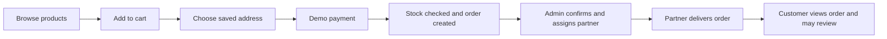

<div align="center">

# PurelyProducts 🛍️

### A full-stack marketplace for thoughtful everyday shopping

[](https://purelyproducts.onrender.com)
[](https://react.dev/)
[](https://nodejs.org/)
[](https://www.mongodb.com/)
[](https://github.com/MAHESH549990/PurelyProducts)

**React storefront · Express and MongoDB backend · Customer, admin, and delivery workflows**

</div>

---

## 🧭 Explore the README

<details open>
<summary><strong>Click to jump to a section</strong></summary>

- [What you can do](#-what-you-can-do)
- [How the smart features work](#-how-the-smart-features-work)
- [Checkout and estimated profit](#-checkout-and-estimated-profit)
- [Technology and project map](#-technology-and-project-map)
- [Run it locally](#-run-it-locally)
- [Main workflows](#-main-workflows)
- [Security and known limits](#-security-and-known-limits)
- [Troubleshooting](#-troubleshooting)
- [Contributors](#-contributors)

</details>

## ✨ What you can do

<details open>
<summary><strong>🛒 Customer storefront</strong></summary>

- Create an account, sign in, update a profile, and save delivery addresses.
- Browse products, inspect product details and reviews, and manage a cart.
- Complete a simulated checkout and track order status.
- Post reviews with optional photos and remove your own reviews.
- Get a ₹35 delivery charge when the product subtotal is below ₹299.
- Get 8% off the product subtotal when a single order contains at least two item units; multiple units of one product count too.
- Chat in English or Hindi and get recommendations based on shopping activity.

</details>

<details>
<summary><strong>🧰 Admin workspace</strong></summary>

- Create and edit products, upload product photos, and manage stock.
- Review customer and order details, confirm orders, and assign delivery partners.
- Review delivery partner applications and browse partner details.
- Inspect delivered-order revenue, saved product costs, delivery fees, partner payouts, and estimated profit.

</details>

<details>
<summary><strong>🚚 Delivery partner workspace</strong></summary>

- View assigned orders with customer, item, and address details.
- Update delivery progress and mark orders delivered.
- View delivery history, profile details, and a graph of earnings.
- Project payout rule: ₹40 for each delivered order, regardless of item count.

</details>

## 🧠 How the smart features work

### Personalized recommendations

For a signed-in customer, the backend uses recent searches, cart additions, the current cart, and recent non-cancelled orders as interest signals. It compares those signals with product names and categories; matching descriptions can contribute with a lower weight. Recommendations are in-stock products that pass the match threshold, with products already in the cart or recent orders filtered out.

> A first-time customer has no activity-based recommendations yet. If products do not match the activity, the list stays empty instead of filling with unrelated items.

<details>
<summary><strong>Recommendation API</strong></summary>

| Method | Endpoint | Purpose |
| --- | --- | --- |
| `POST` | `/api/recommendations/search` | Record a meaningful signed-in search |
| `GET` | `/api/recommendations` | Return products matched to that customer's activity |

</details>

### English and Hindi shopping assistant

The assistant handles greetings and general questions, checks availability against catalogue data, and explains how to add items to the cart and check out. Built-in replies support common shopping questions in both languages. When `GEMINI_API_KEY` is configured, Gemini can provide more conversational responses using relevant product information.

The assistant is rate-limited. It does not place orders or read private order and address details. Endpoint: `POST /api/chat`.

## 💸 Checkout and estimated profit

Payment is simulated; the app does not connect to a payment gateway or charge a card. The server calculates checkout totals, checks stock, creates the order after the demo payment step, and updates inventory. Delivery costs ₹35 when the pre-discount product subtotal is under ₹299. A single order with at least two item units gets 8% off its product subtotal; multiple units of one product count. The server applies the discount and saves its amount and percentage on the order.

### Admin profit report

The admin report estimates profit from delivered orders that have complete checkout-time cost snapshots:

```text
Estimated profit = gross product sales - discounts - product cost + delivery fees - delivery partner payout
```

| Report value | Source |
| --- | --- |
| Gross product sales | Selling price saved at checkout × quantity |
| Discounts | Order-level discount saved at checkout |
| Net product revenue | Gross product sales − discounts |
| Product cost | Admin-entered purchase cost saved at checkout × quantity |
| Delivery fees | Delivery charge collected for the order |
| Partner payout | ₹40 per delivered order, or the saved payout if present |
| Estimated profit | Net product revenue − product cost + fees − partner payout |

<details>
<summary><strong>Notes about profit history</strong></summary>

- Enter a purchase cost when creating or editing each product. Purchase cost is private and excluded from customer-facing product queries.
- New checkout sessions save the selling price and purchase cost on the order, so future product edits do not change the order's snapshot.
- Delivered orders missing cost snapshots are excluded from profit and shown as missing history. The report does not guess historical purchase costs.
- Taxes, payment fees, returns, and other operating costs are not included. Treat the chart as an estimate from tracked costs, not accounting profit.
- The delivery partner graph continues to show the ₹40 per delivered-order payout rule.

</details>

## 🧱 Technology and project map

| Area | Tools |
| --- | --- |
| Frontend | React, Vite, CSS |
| Backend | Node.js, Express 5 |
| Database | MongoDB, Mongoose |
| Authentication and sessions | Passport.js, Express Session |
| Validation and uploads | Joi, Multer, Cloudinary |
| Optional assistant generation | Gemini API |
| Optional interactive profile maps | Mapbox |

```text
PurelyProducts/
├── admin/        Admin product, inventory, customer, and order routes
├── delivery/     Delivery partner routes and workflows
├── frontend/     React source and Vite configuration
├── models/       Mongoose data models
├── public/       Static files and production React build
├── user/         Customer, product, order, review, and API routes
├── utils/        Shared helpers, including earnings calculations
├── index.js      Express entry point and route mounting
└── schema.js     Joi validation schemas
```

React page modules and route mapping: [frontend/src/pages/README.md](frontend/src/pages/README.md).

## 🚀 Run it locally

<details open>
<summary><strong>1. Install the app</strong></summary>

You need Node.js, npm, MongoDB, and Cloudinary credentials for image uploads.

```bash
git clone https://github.com/MAHESH549990/PurelyProducts.git
cd PurelyProducts
npm install
```

</details>

<details>
<summary><strong>2. Configure environment variables</strong></summary>

Create a private `.env` file in the project root. Replace the example values with your own credentials; never commit this file.

```dotenv
PORT=8080
ATLAS_URL=your_mongodb_connection_string
SECRET=your_session_secret

CLOUDINARY_CLOUD_NAME=your_cloud_name
CLOUDINARY_API_KEY=your_cloudinary_api_key
CLOUDINARY_API_SECRET=your_cloudinary_api_secret

GEMINI_API_KEY=your_optional_gemini_api_key
MAP_TOKEN=your_optional_mapbox_public_token

ADMIN_NAME=your_admin_username
ADMIN_EMAIL=your_admin_email
ADMIN_PASSWORD=your_admin_password
```

</details>

<details>
<summary><strong>3. Start the server or build the frontend</strong></summary>

Start Express at [http://localhost:8080](http://localhost:8080):

```bash
npm start
```

For frontend development, run Express and Vite in separate terminals:

```bash
npm run dev
```

Create the production React bundle:

```bash
npm run build
npm start
```

Vite writes the production bundle to `public/app`. On Render, use `npm install && npm run build` as the build command and `npm start` as the start command. Configure secrets through Render's environment settings.

</details>

## 🔄 Main workflows

### Customer order journey



### Product and inventory management

Admins can create or edit product details, upload or replace Cloudinary images, enter purchase cost, and set on-hand stock. Saving stock sets the new quantity; it does not add to the previous quantity. Purchase cost and order snapshots support the estimated-profit report.

### Delivery partner application

Customers submit an application with contact and vehicle details. Admin reviews the request; approved partners can receive order assignments.

## 🔐 Security and known limits

- Protected routes enforce the user's role on the server.
- Login and flash sessions are stored in MongoDB, use a rolling 14-day cookie lifetime, and require a stable `SECRET` (or `SESSION_SECRET`) set in both local and Render environments.
- Customer order access and review deletion are scoped to ownership.
- Checkout totals and stock are calculated or checked by the backend.
- Payment is simulated; no real card is charged.
- Recommendations use weighted rules, not a trained machine-learning model.
- Gemini replies depend on provider configuration and availability.
- The `npm test` script is a placeholder; an automated test suite is not configured.

## 🧯 Troubleshooting

<details>
<summary><strong>MongoDB authentication or SRV lookup fails</strong></summary>

Check `ATLAS_URL`, verify the Atlas database user's credentials, and URL-encode special characters in the password. For SRV errors, check DNS SRV resolution and the Atlas hostname; a successful TCP connection by itself does not confirm SRV resolution.

</details>

<details>
<summary><strong>Images, recommendations, maps, or chat are missing</strong></summary>

- **Product/review images:** verify Cloudinary settings, multipart form submission, and server logs.
- **Recommendations:** use the same signed-in account, search specific product names/categories, and add relevant cart or order activity.
- **Profile map:** verify `MAP_TOKEN` and that the saved address has location data.
- **AI-generated chat replies:** verify `GEMINI_API_KEY` and provider availability. Built-in bilingual answers do not require Gemini.

</details>

## 👥 Contributors

| Name | Profile |
| --- | --- |
| Mahesh Bhatt | [@MAHESH549990](https://github.com/MAHESH549990) |
| Rohit Singh | [@rsr200600](https://github.com/rsr200600) |
| Bhawesh Panda | [@Bhawesh0018](https://github.com/Bhawesh0018) |
| Shubham Bisht | [@Shubham649-tech](https://github.com/Shubham649-tech) |

---

<div align="center">

Made with care by the PurelyProducts team · [Open the live store](https://purelyproducts.onrender.com) · [View the source](https://github.com/MAHESH549990/PurelyProducts)

</div>
